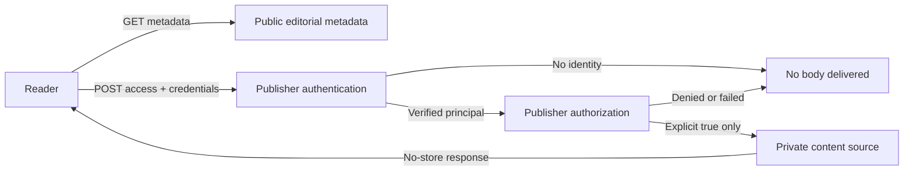

# ContentGate reference library

Small, framework-agnostic content authorization. Bring your own authentication,
subscription policy, and private content source. The TypeScript core has **zero
runtime dependencies** and uses native Web `Request` and `Response` objects.

A client-side paywall cannot protect text already sent to a browser. ContentGate
checks access on the server **before retrieving the article body**. Public titles,
editorial synopses, and sharing metadata stay separate from protected content.



## Five-minute integration

Build from this repository (`npm ci && npm run build`). The package is not yet
published; `npm pack` creates an installable tarball for another application.
Import it only in server code:

```ts
import { createContentGate } from 'contentgate';

export const gate = createContentGate({
  authenticate: async request => existingAuth.verifySession(request), // user or null
  authorize: async ({ user, contentId }) =>
    subscriptions.hasAccess(user.id, contentId), // boolean, checked on every request
  getContent: async contentId => privateCMS.getArticle(contentId), // object or null
  getMetadata: async contentId => publicCatalog.getMetadata(contentId), // optional
});

// Mount at /v1/content/:id and /v1/content/:id/access in your HTTP server.
export const handler = (request: Request) => gate.handle(request);
```

These provider names represent your existing services. `authenticate` must verify
credentials, not trust a browser-supplied user ID. Returning `true` from `authorize`
is the only way to reach `getContent`. Exceptions return a generic 503; no provider
error or private data is logged by the core.

| Request | Result |
| --- | --- |
| `GET /v1/content/:id` | Public metadata, `{ "data": { ... } }` |
| `POST /v1/content/:id/access` (no body) | Protected content, `{ "data": ... }`, only if permitted |
| Missing identity | 401, `{"error":{"code":"unauthenticated"}}` |
| Denied permission | 403, or 404 with `hideDenied: true` |
| Missing resource | 404; protected source checked only after permission |
| Invalid identifier/body / wrong method | 400 / 405 |
| Provider or serialization failure | 503, `{"error":{"code":"unavailable"}}` |

Content IDs are 1–128 ASCII letters, digits, `_`, or `-`, starting with a letter or
digit. A metadata record has `id`, `title`, `description`, `author`, `publishedAt`,
`image`, and `canonicalUrl`. Only these string fields are serialized. All responses
default to `private, no-store`; metadata caching is an explicit publisher choice.

## Try the reference publication

Requires Node.js 22+ and npm. Run from the repository root:

```sh
npm ci
npm run demo
```

Open [the demo](http://127.0.0.1:3000). The anonymous edition works without any
configuration. For local subscriber requests, copy
`examples/nextjs-blog/.env.example` to `.env.local` in the same directory. Set three
distinct random tokens of at least 32 characters. Generate each locally with
`node -e "console.log(require('node:crypto').randomBytes(32).toString('hex'))"`.
Restart the demo after editing. Keep the tokens out of version control and logs.

```sh
# 401: neither the body nor a content lookup is authorized
curl -i -X POST http://127.0.0.1:3000/v1/content/the-public-boundary/access

# 200: replace the placeholder with your local DEMO_SUBSCRIBER_TOKEN
curl -i -X POST -H "Authorization: Bearer <local-subscriber-token>" \
  http://127.0.0.1:3000/v1/content/the-public-boundary/access

# Server-rendered full article, without running JavaScript
curl -H "Authorization: Bearer <local-subscriber-token>" \
  http://127.0.0.1:3000/articles/the-public-boundary
```

On Windows use `curl.exe` if your shell aliases `curl`. To view the subscriber
edition in a browser, set a local `contentgate_demo` cookie to that same token in
developer tools and reload. Remove it to return to the public edition. This is a
local testing mechanism, **not a production session system**. No login or billing
UI is included. Replace `lib/gate.ts` with your real providers before deployment.

## Frameworks and HTTP clients

- **Next.js:** working App Router demo; thin route example in `adapters/nextjs`.
- **Astro:** SSR endpoint example in `adapters/astro`; requires a server adapter.
- **WordPress:** PHP HTTP client example and explicit storage/security guidance.
  It does not protect existing public WordPress posts or plugin endpoints.
- **Other backends:** call the hosted HTTP endpoint with a validated user credential.
  The demo can be self-hosted with `npm run demo:build` and
  `npm run start --workspace examples/nextjs-blog`; configure TLS and your providers.

See [integration.md](integration.md) for mounting, SSR, PHP, and credential
boundaries. There is no database, subscription service, or authentication server
inside ContentGate.

## Security and SEO

Protect the original CMS, feeds, GraphQL, previews, exports, static builds, and
media routes too. ContentGate cannot revoke copies that a public endpoint already
delivered. Never cache subscriber responses in a shared CDN, framework data cache,
or service worker. The demo disables static article generation and checks both
API and rendered-page delivery. See [security.md](security.md).

Public pages expose genuine synopses, canonical URLs, author/date information,
Open Graph tags, and paywall JSON-LD. The demo uses `isAccessibleForFree: false`
and a `.protected-article` selector following
[Google's paywall markup conventions](https://developers.google.com/search/docs/appearance/structured-data/paywalled-content).
It gives bots the same anonymous access as readers: metadata can be indexed, but
the unavailable body cannot. Markup is neither an access control nor a guarantee
of rich results. Replace localhost canonical URLs for deployment.

## Development and verification

```sh
npm test                 # Core security and HTTP-contract tests
npm run typecheck        # Core + Next.js demo
npm run lint
npm run test:demo        # Production build + real localhost HTTP checks
npm pack --dry-run       # Inspect the publishable package
```

The demo verifier starts its own server on port 3137, supplies fresh in-memory mock
tokens, and stops the server afterward. It checks anonymous, denied, expired,
forged, and authorized requests; server HTML without executing JavaScript; RSC;
bot requests; no-store headers; and public assets for private fixture text. These
tests verify this implementation, not the configuration of your production CMS
or CDN. The Astro and PHP files are integration templates, not tested applications.

Read [architecture.md](architecture.md) for the small design and trade-offs.
Licensed under [MIT](../LICENSE).
